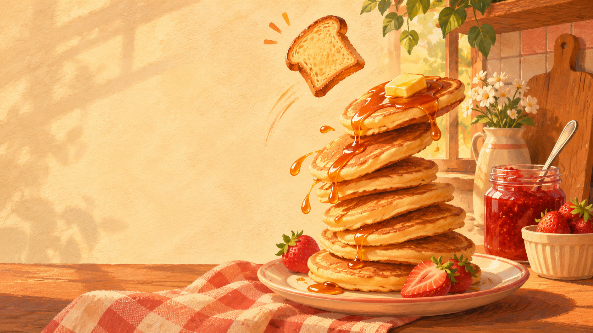

# Little Arcade

Small browser games and playful worlds for a short break. Open a game, play immediately, and come back whenever you like. No account is needed.



**[Watch the 16-second visual tour](media/little-arcade-tour.mp4)** · [Open the game launcher](index.html)

## Pick a game

| Game | What you do | Start |
| --- | --- | --- |
| **Breakfast Arcade** | Play three quick kitchen games: stack pancakes, catch toast, and dunk cookies. Each uses one button; your best scores stay in this browser. | [Play](breakfast-arcade/breakfast-arcade.html) |
| **Pancake Tower** | Time each drop and build the tallest stack you can. | [Play](pancake-tower/pancake-tower.html) |
| **Little Harvest** | Grow a field, make paths, build cottages, and help a tiny village flourish. | [Play](little-harvest/dist/index.html) |
| **One Minute Planet** | Move the sun, guide a cloud, and pull the moon to change seasons, rain, and tides on a living 3D globe. | [Play](one-minute-planet/dist/index.html) |


## Play locally

Breakfast Arcade and Pancake Tower are self-contained HTML files; you can download and open either file directly. To play all four from a local folder, run:

```sh
python3 -m http.server 8000
```

Then visit `http://localhost:8000/` and choose a game. The 3D games load their JavaScript and Three.js from this repository. Their optional web fonts may fall back to system fonts when offline. The launcher and the games require no sign-in.

## About the visuals

The two images above are original promotional illustrations, not gameplay screenshots. The video is a short illustrated overview of the collection. The games themselves are interactive and use different visual styles. Breakfast Arcade and Pancake Tower are single-file games; Little Harvest and One Minute Planet use a local copy of Three.js. See the vendored Three.js license files in each game directory.
